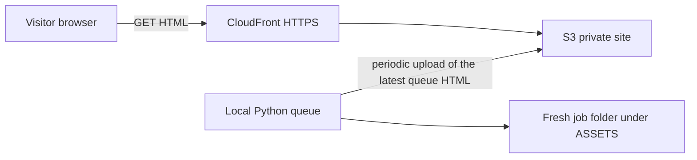

# Public portal and local queue

A public HTTPS website on AWS, and a separate local Python app that owns the queue. The app runs in a local Python environment. On a period it uploads the latest queue into the site on S3. The HTML CloudFront serves is that publish.

The laptop owns the queue. AWS serves the last publish. While the local app is not running, the site keeps showing the HTML from the previous upload.

## Site

The site is a private S3 bucket behind CloudFront. An origin access control is the bucket's reader. The certificate is an ACM certificate in us-east-1, which is where CloudFront reads certificates. One custom domain, HTTPS only. Route 53 registers the domain and points it at the distribution.

CloudFront serves the static site. The queue page is an object in that bucket. The local app overwrites that HTML on a period, and visitors read the object CloudFront fetches from S3.

## Queue

The queue lives in the local Python app. That app is a separate script and process from the site. It is the store: queued, running, and finished work are local state. AWS has no queue table and no API in front of the queue.

On a period the app renders the latest queue into the site HTML and uploads that object to S3. A missed period leaves the previous HTML in place until the next successful upload. Publishing the queue is separate from a deploy of the rest of the site shell.

The app creates a fresh folder under `ASSETS/` for each job and starts the allowlisted command for that job. The command may spawn subprocesses. Those children stay in the job's process group and end with the job. The first handler is `echo`: it writes the payload into the job folder and exits.

The YouTube list in `queue.txt` is drained by this same process, one URL at a time. The child is a full-auto episode in the `interview_helper_mux` checkout: that checkout's `.venv/bin/python -m interview_mux orchestrate --mode full-auto --url`. The URL stays on the public page while the child runs. When the child exits, the portal writes the outcome under `ASSETS/orchestrations/` and removes the URL, waits five seconds, and starts the next one. An empty list waits for a new URL. The contract is [queue-orchestrator.md](queue-orchestrator.md).

The allowlisted product checkout is the directory `interview_helper_mux`. The app starts that product from that directory. This overview names the directory. The product that lives there keeps its own documentation.

Per-job files, including those work folders, stay under `ASSETS/`. See [repository.md](repository.md) for the path keys, and for the stacks, structures, and frameworks the portal code is written in.

## Logging

The local app logs to stdout. The site does not create CloudWatch log groups, and the local app does not ship logs to AWS.

## Security

The browser holds no AWS credentials. The local app reads `config/secrets/secrets.env` for the credentials it uses to upload the queue HTML. A job process does not receive those secrets. The app maps a job to a fixed command. An unknown job kind is marked rejected and is not executed.

## v1 boundary

v1 is a local queue plus a periodic upload of the queue HTML to S3. Visitor accounts, a shell command supplied by a visitor, and a websocket are outside this version.

## Where the code will live

These directories are the intended homes. They are named here as a map. This documentation pass does not create them.

- `site/` — the static page, including the queue HTML the local app republishes.
- `agent/` — the local Python queue, the allowlist, and the periodic upload to S3.
- `terraform/` — S3, CloudFront, ACM, and Route 53.

The repository rules for config, secrets, local files, Terraform, and Python are in [repository.md](repository.md).
