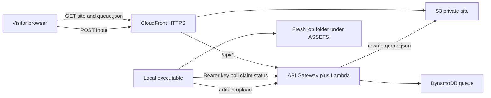

# Public portal and local runner

A public HTTPS website on AWS, and a key-authenticated executable on the operator's computer. Visitors submit inputs. The queue is visible on the site. The executable claims work, runs it locally, and publishes status and files back. The static files the site shows are rewritten immediately when an input arrives or a status changes, and again on a periodic reconcile.

The laptop is the worker. It owns execution. AWS is the public front door, so a new row can appear while the laptop is asleep.

## Site

The site is a private S3 bucket behind CloudFront. An origin access control is the bucket's reader. The certificate is an ACM certificate in us-east-1, which is where CloudFront reads certificates. One custom domain, HTTPS only.

CloudFront has three behaviors:

- The default behavior serves the site shell from S3 and caches it.
- `data/queue.json` is served from S3 with caching disabled, so the list can change without an invalidation.
- `/api/*` is API Gateway on the same domain, with caching disabled. The form stays same-origin.

## How an input becomes a run

1. A visitor posts an input to `/api/inputs`. The body is a `kind` and a size-capped payload.
2. That request stores a `queued` item in DynamoDB and rewrites `data/queue.json` on S3 before it returns.
3. The page shows the returned row at once. Other visitors see it on the next fetch of `queue.json`.
4. The local executable polls with a bearer key, claims the item, and reports `running`. That status rewrite updates `queue.json` the same way.
5. The executable creates a fresh folder under `ASSETS/`, writes the input there, and starts the allowlisted command for that `kind`. The command may spawn subprocesses. Those children stay in the job's process group and end with the job.
6. The executable uploads output files and reports `done` or `failed`, including a short log tail. The site list updates again.

DynamoDB is the durable queue, one table, job id as the key. `queue.json` is the public read model. A conditional claim keeps two processes from taking the same item.

## When the laptop is offline

Inputs still land and show as `queued`. Nothing runs until the executable polls again.

## Periodic republish

The executable sends a heartbeat every few seconds. That pass rewrites the published queue and the asset list again, so a missed immediate write does not leave the site stale. The heartbeat is a reconcile, separate from a deploy of the site shell.

## Local runner

One process. Its loop is heartbeat, poll, claim, run, upload, report. The allowlist of commands lives on the machine. A later `kind` can point at another local command. The first handler is `echo`: it writes the payload into the job folder and exits, which is enough to prove submit, the live list, claim, a subprocess, an artifact, and status.

The allowlisted product checkout is the directory `interview_helper_mux`. The runner starts that product from that directory. This overview names the directory. The product that lives there keeps its own documentation.

Per-job files, including those work folders, stay under `ASSETS/`. See [repository.md](repository.md) for the path keys, and for the stacks, structures, and frameworks the portal code is written in.

## Security

Visitors send inputs. The API accepts a `kind` and a size-capped JSON payload. The executable maps `kind` to a fixed command. An unknown `kind` is marked rejected and is not executed.

The browser holds neither the agent key nor AWS credentials. Public routes are the input post and reads of the static files. Agent routes require the bearer key. The key and the AWS credentials live only in `config/secrets/secrets.env`. The job process does not receive those secrets. Lambda is the component that writes the bucket and the table.

## v1 boundary

v1 is polling plus an immediate rewrite of `queue.json`. Visitor accounts, a shell command supplied by the visitor, and a websocket are outside this version.

## Where the code will live

These directories are the intended homes. They are named here as a map. This documentation pass does not create them.

- `site/` — the static page: form, queue list, status.
- `lambda/` — the HTTP API: public submit, agent claim, status, artifacts, and heartbeat.
- `agent/` — the local executable and the allowlist.
- `terraform/` — S3, CloudFront, ACM, Route 53, the HTTP API, Lambda, DynamoDB, and IAM.

The repository rules for config, secrets, local files, Terraform, and Python are in [repository.md](repository.md).
